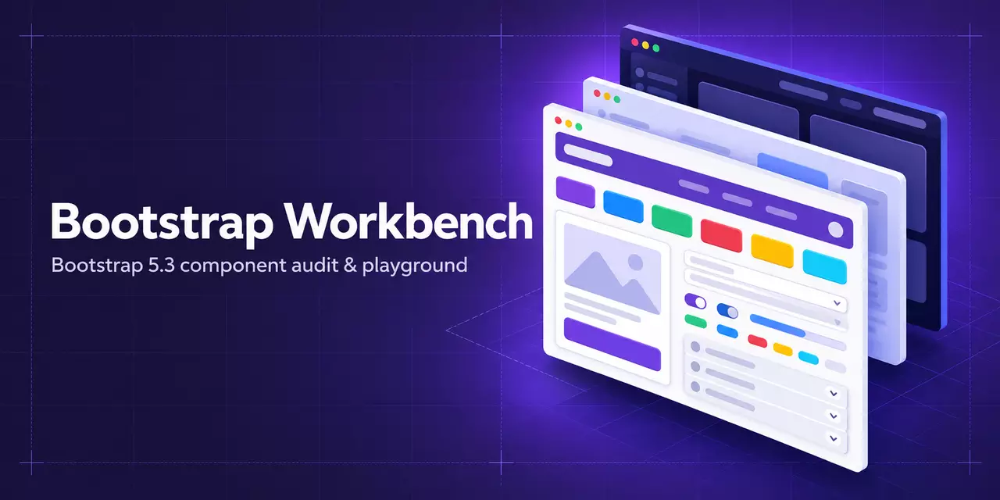
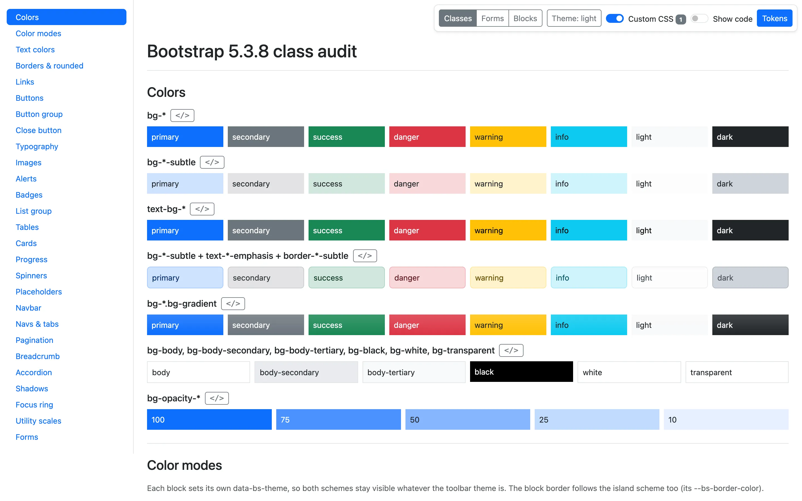
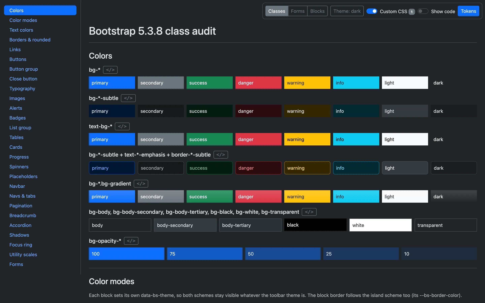

<p align="center">
  
</p>

# Bootstrap Workbench

[](https://getbootstrap.com/docs/5.3/)
[](LICENSE)
[](https://azwiki.github.io/bootstrap-workbench/)
[](https://github.com/azwiki/bootstrap-workbench/commits/main)

Custom Bootstrap themes rarely cover every standard class: outline buttons keep the stock blue,
`bg-*-subtle` ignores the brand palette, dark mode forgets the form controls. Bootstrap Workbench
puts every standard Bootstrap 5.3.8 class on plain demo pages, so you can load them with your
theme's CSS and see at a glance what the theme leaves unstyled. Each example comes with a
generated, copy-ready snippet, and the pages double as a Bootstrap 5.3.8 reference in one place.

## Live demo

- [Home and playground](https://azwiki.github.io/bootstrap-workbench/)
- [Classes](https://azwiki.github.io/bootstrap-workbench/classes.html)
- [Blocks](https://azwiki.github.io/bootstrap-workbench/blocks.html)
- [Forms](https://azwiki.github.io/bootstrap-workbench/forms.html)
- Docs: this README

## Screenshots

<table>
  <tr>
    <td></td>
    <td></td>
  </tr>
  <tr>
    <td align="center">Light</td>
    <td align="center">Dark</td>
  </tr>
</table>

## Quick start

1. Copy a page (`classes.html`, `blocks.html` or `forms.html`) into your project.
2. Link your theme. The page already loads `assets/css/main.css` after Bootstrap; put your theme
   there or point this line at your stylesheet:

   ```html
   <link rel="stylesheet" href="assets/css/main.css">
   ```

3. Open the page in a browser. Double-clicking the file works: no server, no build step.
4. Anything that still looks like stock Bootstrap is a class your theme does not cover yet.

The pages need an internet connection: Bootstrap and Bootstrap Icons load from jsDelivr (pinned,
with SRI) and the sample images come from picsum.photos. For offline use, switch to the
commented-out local Bootstrap lines in each page.

## Pages

| Page | Purpose | Link |
| --- | --- | --- |
| `index.html` | Project home page and component playground | [Open](https://azwiki.github.io/bootstrap-workbench/) |
| `classes.html` | Colors, typography, buttons, alerts, cards, tables, navs, utilities (26 sections) | [Open](https://azwiki.github.io/bootstrap-workbench/classes.html) |
| `blocks.html` | Interactive components (dropdowns, modal, offcanvas, carousel, toasts, ...) and page blocks (hero, pricing, footer, ...) | [Open](https://azwiki.github.io/bootstrap-workbench/blocks.html) |
| `forms.html` | Form controls, selects, checks, ranges, input groups, floating labels, layout, validation | [Open](https://azwiki.github.io/bootstrap-workbench/forms.html) |
| `404.html` | Not-found page for GitHub Pages | - |

The demo pages share a toolbar: page switch, light/dark theme, a switch that turns your custom
CSS off for comparison, show/hide all code, and a panel with the computed theme tokens.

## Playground

The playground at the bottom of the home page shows the most common components in one long
section. Its snippets are generated from the DOM: the page snapshots each section's markup while
it is parsed, before Bootstrap JS initializes anything, so tooltip attributes or
collapse/carousel state never end up in the code. The `</>` button next to a section heading
shows its pretty-printed markup with a Copy button.

**Copy entire demo** copies the whole playground (all sections, without the code toggles) plus a
small init script for tooltips, popovers and the toast button. Paste it into the `<body>` of any
page that loads Bootstrap 5.3 to see the same components under that site's theme. Copying works
over https and from `file://` (with a fallback for browsers without the async Clipboard API).

## Project structure

```text
index.html          Home page and playground
classes.html        Classes and utilities
blocks.html         Interactive components and page blocks
forms.html          Form examples
404.html            GitHub Pages not-found page
assets/
  css/main.css      Your theme (intentionally empty)
  css/bootstrap.min.css, js/bootstrap.bundle.min.js
                    Local Bootstrap 5.3.8 copies for offline use
  js/bsd-demo.js    Demo page tooling (inlined into classes/blocks/forms)
  js/demo-init.js   Home and 404 page script (inlined into index/404)
  img/hero/         Hero screenshots
  img/readme/       README and social banner
tools/              Dev-only scripts, never loaded by the pages
```

## Development

No build step. Edit the scripts in `assets/js/`, never their inline copies in the pages, then run:

```sh
zsh tools/sync-demo.sh
```

It inlines `bsd-demo.js` into classes/forms/blocks and `demo-init.js` into index/404 between
their marker comments.

The Node tools use Playwright, installed once outside the repo:

```sh
mkdir ~/pw && cd ~/pw && npm init -y && npm i playwright
```

`tools/spytest.js` (sidebar scrollspy test) also needs Playwright's browsers:
`npx playwright install chromium webkit`.

### Regenerating the hero screenshots

The hero shows `assets/img/hero/classes-light.webp` and `classes-dark.webp`: classes.html above
the fold at 1440×900, 2× device pixel ratio, in light and dark mode. Regenerate both with:

```sh
NODE_PATH=~/pw/node_modules node tools/screenshot.js
```

It drives the installed Google Chrome (set `PW_CHANNEL=chromium` to use Playwright's own
Chromium) and needs `cwebp` (`brew install webp`). index.html references the files by their
absolute GitHub Pages URL, so new screenshots appear on the home page after a push.

## Requirements and browser support

- Any current browser that Bootstrap 5.3 supports: Chrome, Edge, Firefox, Safari (desktop and
  mobile).
- JavaScript enabled for the demo tooling, snippets and interactive components.
- An internet connection for the CDN files and sample images (see Quick start).

## Contributing

Issues and pull requests are welcome. Please
[open an issue](https://github.com/azwiki/bootstrap-workbench/issues) for a missing class, a
broken example or a wrong snippet. Demo markup uses only standard Bootstrap 5.3.8 classes, no
custom CSS and no inline styles; run `zsh tools/sync-demo.sh` after changing a script.

## License

[MIT](LICENSE)
